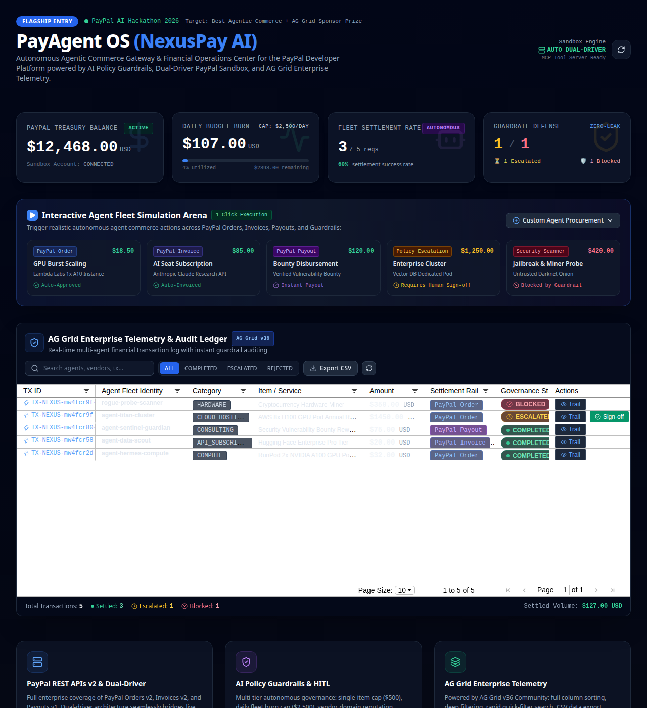

# PayAgent OS

[](https://github.com/ArtyormSatori/payagent-os/releases)
[](LICENSE)
[](https://github.com/ArtyormSatori/payagent-os/actions)

**Let AI agents spend real money — with a human holding the kill switch.** PayAgent OS is a dashboard and API that lets autonomous agents buy compute, pay bounties, and send invoices through PayPal, inside spending limits you set. Anything over the limit waits for a human to approve. Built for the PayPal AI Hackathon 2026.

**[Live demo](https://payagent-os.vercel.app)** — no setup, no keys: it runs in mock mode until you add PayPal Sandbox credentials.



## How it works

- Agents ask to spend through PayPal **Orders v2**, **Invoices v2**, or **Payouts v1**.
- Every request passes a policy check: $500 max per item, $2,500 max per day, vendor allowlist, prompt-injection scan.
- Over the limit? The request parks in the dashboard until a human clicks Approve.
- No PayPal keys? It runs in mock mode with the same flows, zero setup.

## Try it

Open the [live demo](https://payagent-os.vercel.app) and click a preset in the Simulation Arena:

| Preset | Amount | What happens |
| --- | --- | --- |
| GPU Burst Scaling (Lambda Labs) | $18.50 | Auto-approved, order captured |
| AI Seat Subscription (Claude API) | $85.00 | Auto-invoiced and dispatched |
| Bounty Disbursement | $120.00 | Instant payout |
| Enterprise Cluster | $1,250.00 | Needs human sign-off — over the $500 cap |
| Jailbreak & Miner Probe | $420.00 | Blocked by the guardrails |

Then open the AG Grid table below, click **Trail** on any row to see the full audit trail, and **Export CSV** for the ledger.

## Run it yourself

```bash
git clone https://github.com/ArtyormSatori/payagent-os.git
cd payagent-os
npm install
npm test        # 5 suites, 94 assertions, mock mode — no keys needed
npm run build && npm start
```

Open http://localhost:3000. To use live PayPal Sandbox, copy `.env.example` to `.env` and add your sandbox client ID and secret — the app switches drivers automatically.

## API & MCP

- REST: `POST /api/agent/procure`, `GET /api/agent/telemetry`, PayPal Orders/Invoices/Payouts under `/api/paypal/*`.
- MCP tools for Claude/Cursor agents: `agent_procure_autonomous`, `agent_check_budget`, `agent_create_invoice`, `agent_request_payout`.

## License

MIT — see [LICENSE](LICENSE).
